# AI-HUB · 智能测试平台

> 基于 **LangGraph + FastAPI + Vue 3** 的 AI 测试用例全生命周期平台：
> 需求文档 → AI 四步工作流（分析→编写→评审→修订）→ 用例沉淀 → 评审与报告。
> **无需任何 API Key**，内置离线演示模型即可完整体验全流程。

**🚀 在线 Demo（GitHub Pages · 真实运行数据快照）：<https://snow-sakura.github.io/ai-hub/>**

---

## ✨ 核心能力

| 模块 | 说明 |
|------|------|
| 🤖 AI 用例生成 | SSE 流式四步工作流：需求分析 → 用例编写 → AI 评审（评分卡）→ 用例修订 |
| 🔗 **序列生成（v1.4）** | 长需求按 Markdown 标题自动拆分；**免费模型=串行（并发1）**，**付费模型=并行（≤3 槽位）** |
| 📥 结果沉淀 | 候选用例 →人工「采用」→ 保存入用例库（项目关联、可检索/编辑/导出） |
| ⏰ 定时任务 | cron 到点自动跑真实生成，日志含耗时/结果摘要/exec_ref |
| 🧠 评审与评测 | 评审计划走查、AI 评测师基准、测试报告导出 |
| 🎛️ 模型分级 | 模型自带 tier（free/paid），`FREE_MODEL_IDS` 可覆写；ollama 自动识别为免费 |

## 🖥️ 界面总览

### 1. 数据看板
项目、用例、生成趋势一屏总览。
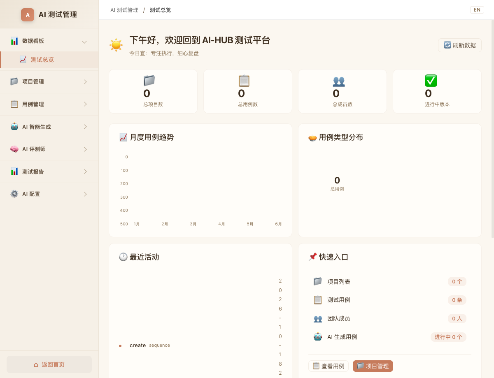

### 2. 项目管理
创建项目作为用例/序列/定时任务的聚合容器。
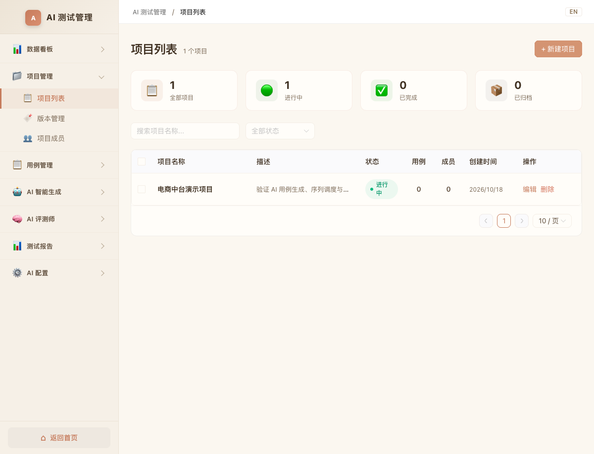

### 3. AI 用例生成 · 流式四步
粘贴需求即刻开工，每一步的思考与 token 实时流出；AI 评审给出维度评分卡并自动触发修订。
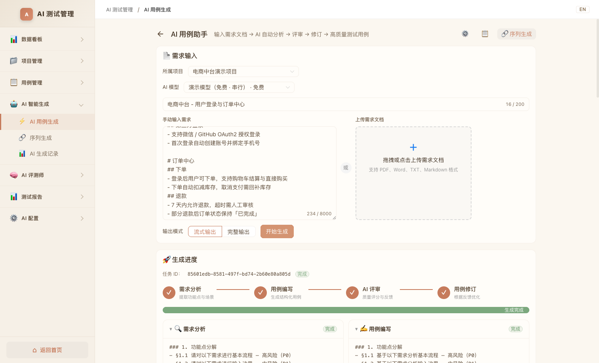


### 4. 生成记录与结果沉淀
任务统计真实可查；进入任务详情将候选用例逐条**采用**后**保存到用例库**，完成"AI 生成 → 人工把关 → 正式资产"闭环。
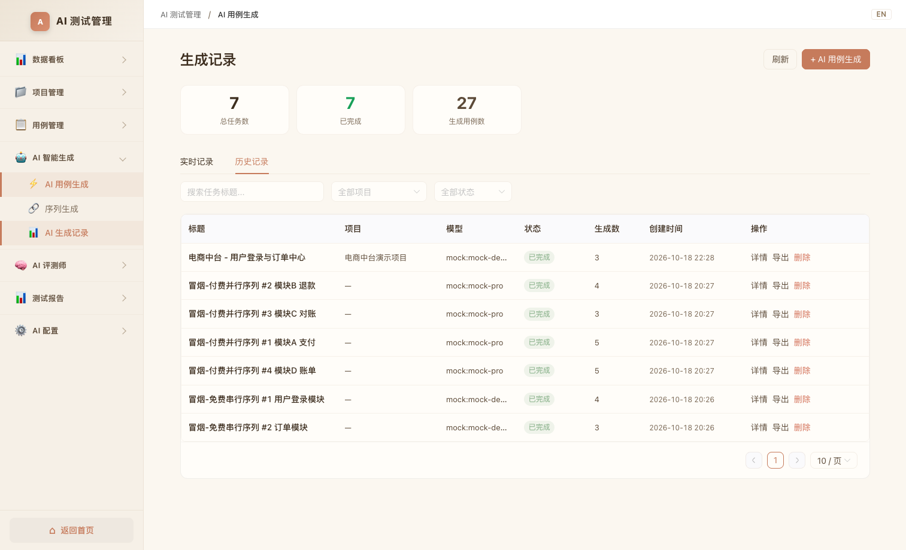
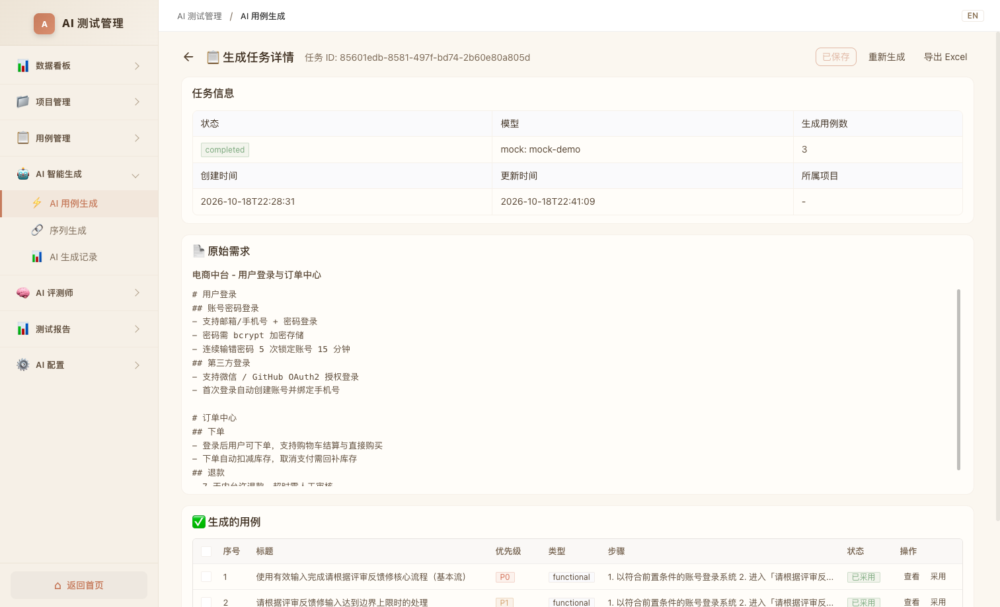
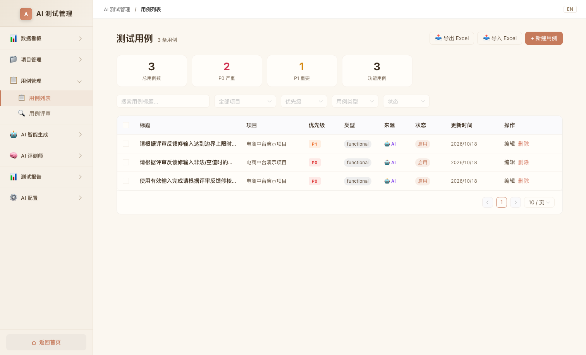

### 5. 序列生成 · 免费串行 / 付费并行
长需求自动拆为有序子任务序列。子任务卡片严格按编号循环展示四步进度：
**免费模型 → 串行 ×1**（逐个执行，保护配额）
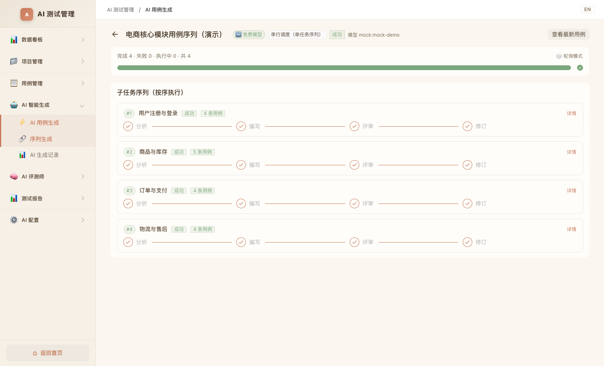
**付费模型 → 并行 ×3**（执行槽位实时点亮，失败可单独重跑）
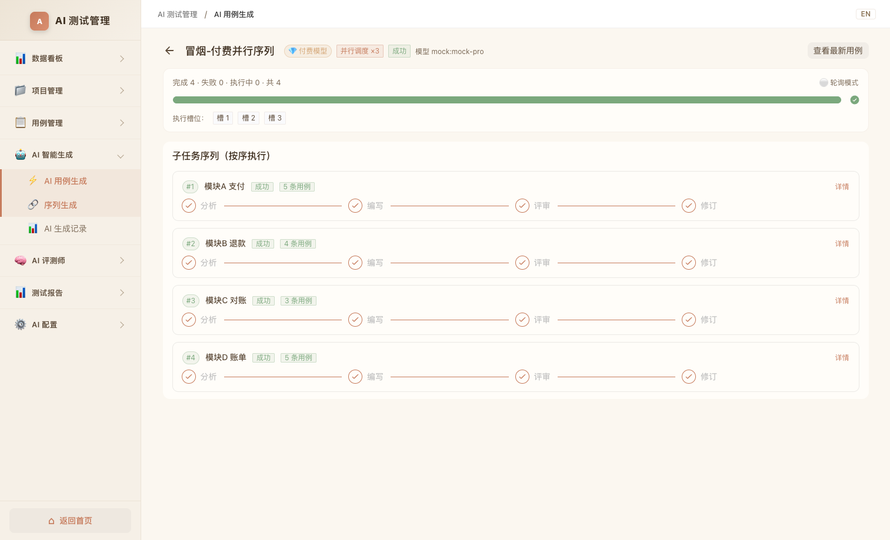

### 6. 定时任务 · 真实执行
关联项目 + 模型 + 需求文本，cron 到点自动创建真实生成任务，日志记录真实耗时与结果（如"3.2s · 生成完成，共 3 条用例"）。
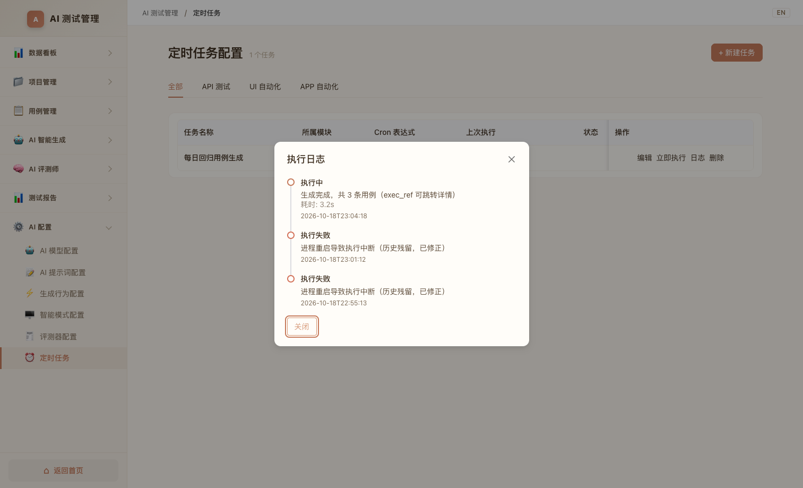

### 7. 评审 / 报告 / 配置中心
评审计划、测试报告与 5 个 AI 配置页（模型/提示词/生成行为/AI 模式/评测器）全部在线可用。
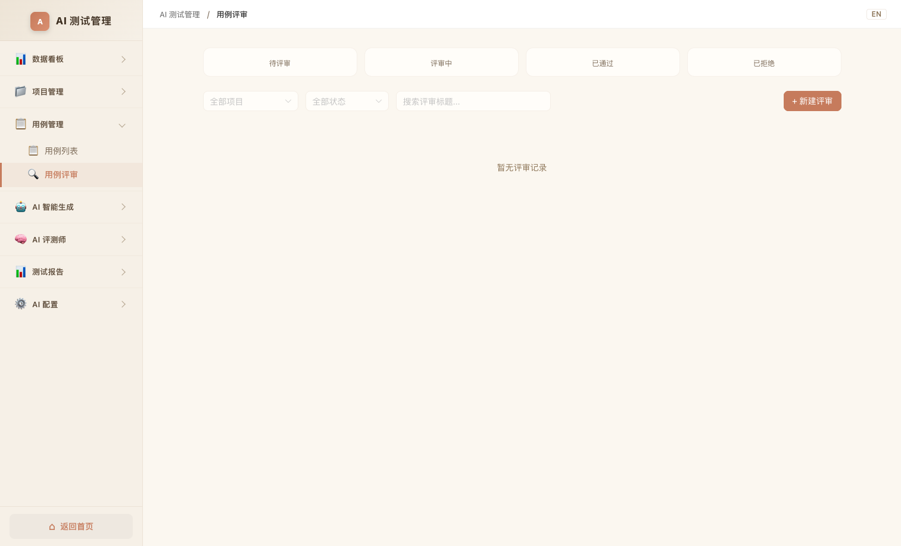
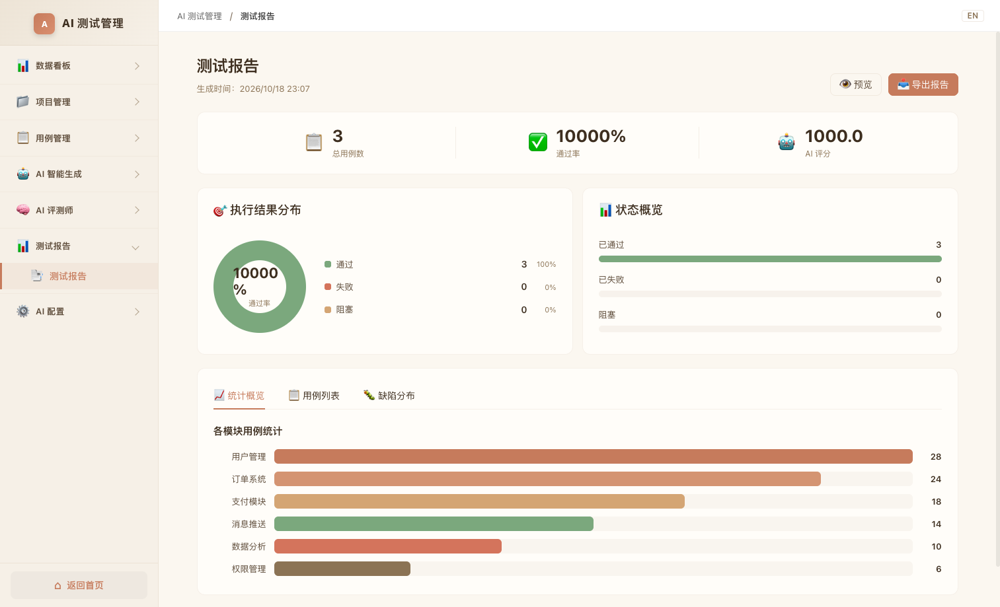
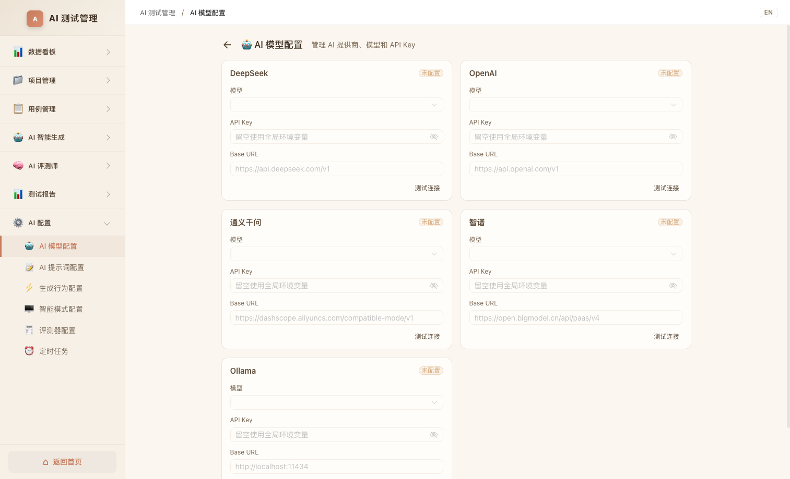

## 🧭 完整使用流程（文字版）

```
登录(admin/admin123) → 建项目 → 粘贴需求 → 选模型(免费/付费) → 流式生成四步
        → 生成记录 → 任务详情「采用」→「保存到用例库」→ 用例管理
长需求：序列生成 → 自动拆分 → 串行/并行调度 → 取消/重跑
例行化：定时任务(cron) → 自动真实执行 → 日志追溯
```

## 🚀 快速开始

```bash
# 1) 后端（Python 3.11+，数据库 MySQL 8）
cd ai-hub/backend
python3 -m venv .venv && source .venv/bin/activate
pip install -r requirements.txt
cp .env.example .env          # 直接保留即可（离线 mock 模型）；填 Key 则用真实模型
uvicorn main:app --host 0.0.0.0 --port 8000

# 2) 前端（Node 18+）
cd ai-hub/frontend
npm install && npm run dev    # 打开 http://localhost:5173
```

多项目共存导致端口冲突时，在 `frontend/.env.local` 设置：
```ini
VITE_BACKEND_URL=http://localhost:8010   # 后端实际端口
VITE_DEV_PORT=5180                       # 前端 dev 端口
```

## 🏗️ 架构摘要

```
API(FastAPI 路由/校验) → Service(业务编排/唯一 DB 操作层) → Repository(MySQL) → Domain
        │ LangGraph 四节点(astream 流式)                mock provider(离线确定性)
        └ SSE: token|reasoning|testing_*|sequence_*    SequenceScheduler(信号量槽位+cron 循环)
```
详见 [docs/technical-v1.4.md](docs/technical-v1.4.md) · [docs/architecture.md](docs/architecture.md)

## 📚 文档索引

| 文档 | 内容 |
|------|------|
| [docs/user-guide.md](docs/user-guide.md) | 📖 操作说明（截图step-by-step） |
| [docs/requirements-v1.4.md](docs/requirements-v1.4.md) | 📋 需求文档（问题→需求→验收） |
| [docs/technical-v1.4.md](docs/technical-v1.4.md) | 🔧 技术文档（根因/设计/API/迁移） |
| [docs/spec-v1.4-generation-sequence.md](docs/spec-v1.4-generation-sequence.md) | 📐 规格与验收清单 |
| [docs/changelog.md](docs/changelog.md) | 版本历史 |
| [ai-hub/demo/](demo/) | 在线 Demo 源（GitHub Actions → Pages） |

## 🔐 安全说明
- `.env`（含 API Key / DB 密码）已在 `.gitignore`，仓库不提交任何密钥；
- JWT 鉴权 + 系统管理（用户/角色/审计）；配置页 API Key 仅存服务端。

---
*AI-HUB v2.2（迭代 v1.4）· 文档与截图随每次 release 更新 · Demo 数据来自真实 Loop Engineering 验证运行*
